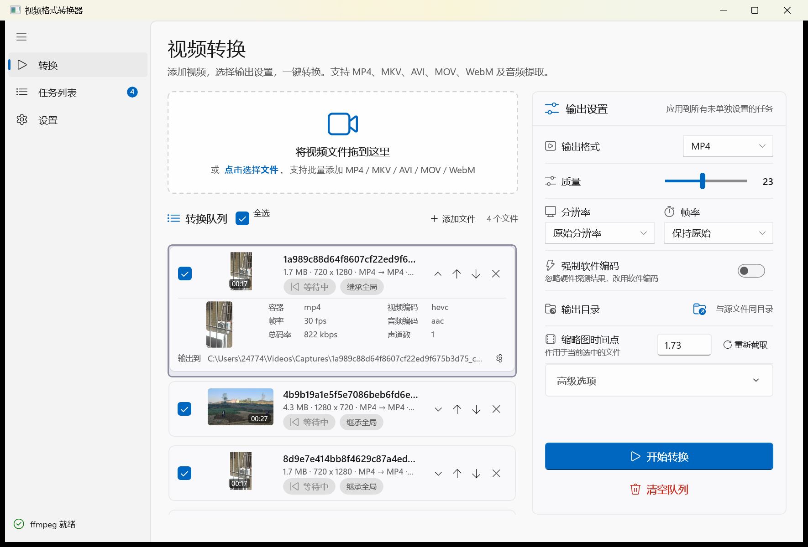
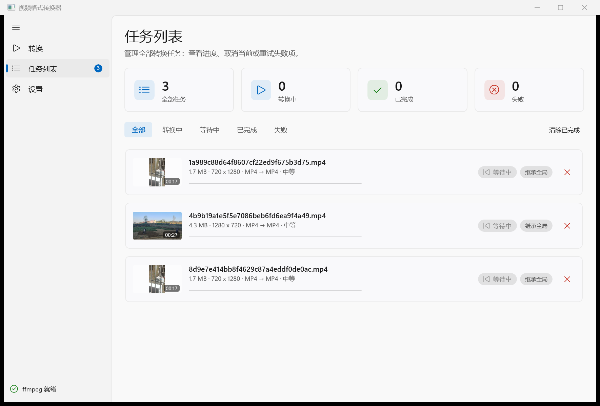
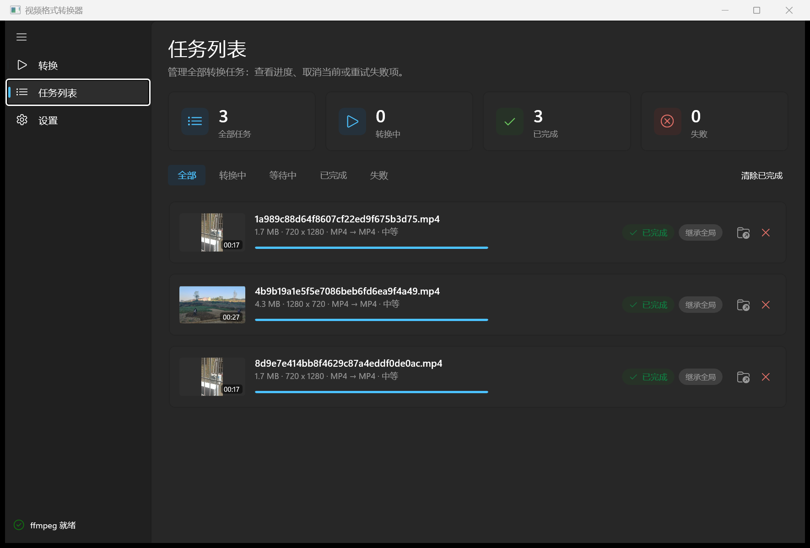
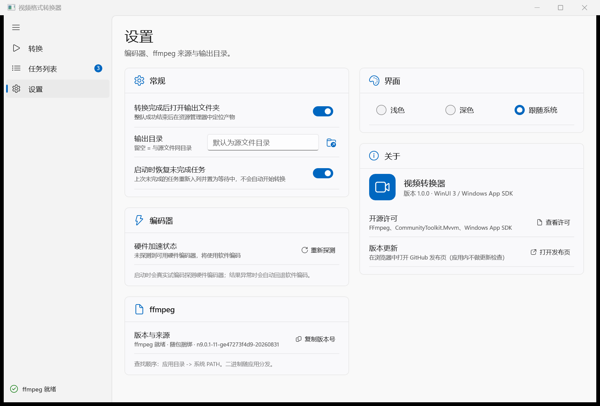
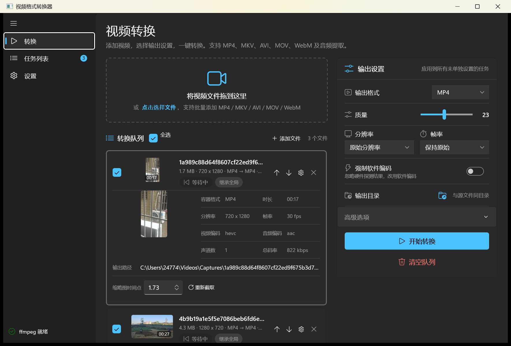
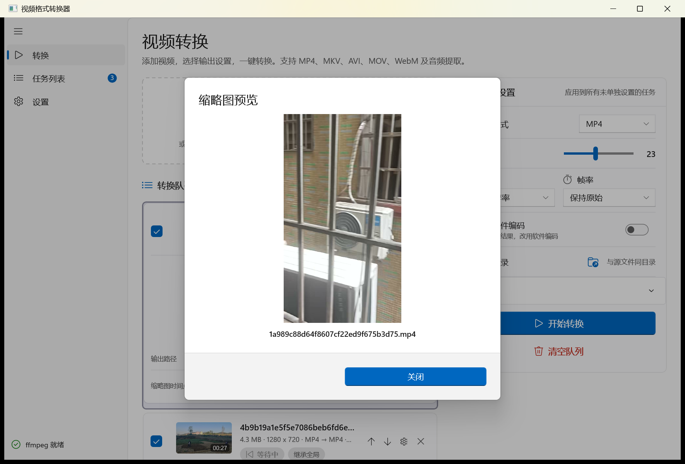

# 视频格式转换器（Windows 桌面客户端）

用 **WinUI 3 + C#/.NET 10** 写的 Windows 原生桌面应用：把视频拖进来，立刻看到媒体信息与真实缩略图，
再用 **ffmpeg 命令行**批量转成想要的格式。

构建 0 警告 0 错误 · 单元测试 199/199 通过 · 端到端验收 14 项 + 各轮界面/交互复测（见[验证](#验证我自己跑过的)）· Windows 10 1809+ / Windows 11



*转换页：拖放或选择文件入队；行尾 `▼/▲` 展开该行媒体信息（可多行同时展开）；
队列区独立滚动，右侧全局参数与「开始转换」常驻，单项参数可覆盖*

## 对笔试要求的逐条回应

| # | 要求 | 本项目的落点 |
|---|---|---|
| 1 | 加载视频信息并显示缩略图 | ffprobe 解析 10 项媒体信息（容器/时长/分辨率/帧率/音视频编码/声道/码率/大小）；ffmpeg 抽帧生成**真实缩略图**三种落点：展开行内 120×68 主预览（竖屏自动加黑边）、每个队列行 96×56 帧、点击放大到 640 宽。取帧时间点默认 `max(1s, 时长×10%)`（避开黑帧/Logo 帧），可手动调整并「重新截取」 |
| 2 | 用 ffmpeg 命令行转换 | 纯进程调用，**不接 ffmpeg API/绑定库**：`FfmpegConversionService` 以 `-progress pipe:1` 解析进度，参数经 `ArgumentList` 逐项传递（空格/中文路径安全），取消时杀进程树并删除残缺产物 |
| 3 | 自行做优化 | 批量队列（严格顺序、四态、失败不中断、两级取消）、硬件编码器**真实试编码**探测与自动回退、参数「继承全局 + 逐项覆盖」、队列与设置持久化 + 重启恢复、输出重名自动 `_1/_2`、浅色/深色/跟随系统主题、开源许可说明；详见[功能](#功能) |
| 4 | 会话总结 md（含开发者决策与反馈） | [总结文档.md](总结文档.md)（仓库根目录）：需求现状、**关键决策记录（逐条附用户反馈依据）**、全功能测试结果、缺陷证据链、已知限制；分阶段日志见 [docs/session-summary.md](docs/session-summary.md) |
| 5 | 提交 GitHub | 本仓库，提交按功能 / 修复 / 文档分开，可读 `git log` 回溯每轮改动的动机 |
| 6 | 界面选型要与「客户端」强相关 | **WinUI 3 + Windows App SDK 2.5.1 的原生 Windows 桌面应用**，`WindowsPackageType=None` 的非打包客户端：原生窗口与标题栏、`NavigationView` 导航、Fluent 视觉与 Mica 材质、系统文件选择对话框、资源管理器定位产物、`%LOCALAPPDATA%` 本地持久化。**界面不含任何 WebView / 浏览器内核**，XAML 直接编译为原生控件 |
| 7 | 给人用，并且自己测过 | 每个功能都由我本机端到端跑过：真机转码 + ffprobe 校验产物、UI Automation 驱动的自动化用例、无人值守截图验收；做不下去的地方（系统文件对话框等）在[已知限制](#已知限制)里如实标注 |

## 界面

| 任务列表（等待中） | 任务列表（全部完成，深色主题） |
|---|---|
|  |  |

| 设置页 | 深色主题（转换页） |
|---|---|
|  |  |



*点击任一缩略图可放大查看（复用缓存帧，不重新调 ffmpeg）*

### 为什么是 WinUI 3

要求里写明「界面选型与客户端关联为 0 就不考虑」，所以选型的第一标准不是我对哪个框架熟，
而是**这看起来、用起来到底是不是一个 Windows 客户端**：

- **原生窗口与系统集成**：原生标题栏与窗口管理、系统文件选择对话框、资源管理器定位产物、
  按 DIP 布局自适应系统缩放（150% 下布局仍然正确）、跟随系统深浅色
- **不选 Electron / Tauri**：为了给 ffmpeg 做个前端却拖进一整套浏览器内核，包体与内存都不划算，
  界面也会退化成"套壳网页"，正是这条要求想避开的形态
- **不选 WPF / WinForms**：WinUI 3 是 Windows App SDK 现行的 UI 框架，Fluent 控件、Mica 材质、
  深浅色主题开箱即用；代价是非打包（unpackaged）模式下坑不少——`dotnet publish` 要自己补
  `.xbf/.pri`、`AppWindow.Resize` 是物理像素而最小尺寸是 DIP、断点不能靠 `VisualStateManager`
  挂在 `ScrollViewer` 内层。踩过的坑与规避方式都沉淀在 [.trellis/spec/](.trellis/spec/)

## 功能

**转换页（工作台）**

- 点击选择（多选）或把文件拖到窗口任意位置入队；重复文件自动去重并提示「跳过 N 个重复文件」
- 队列项：真实帧缩略图 + 时长角标、`大小 · 分辨率 · 原格式 → 目标格式 · 质量`、
  四态徽章（等待中 / 转换中 / 已完成 / 失败）、失败原因、细进度条、勾选参与转换、
  上移/下移/移除；行尾 `▼/▲` 手动展开该行的媒体信息（可多行同时展开，展开状态不落盘）
- 展开区（每行独立）：120×68 真实帧预览 + 3 行 × 2 列技术字段（容器、视频编码、帧率、音频编码、
  总码率、声道数，12px 次级色）+ 输出路径一行小字 + 齿轮（单独覆盖该项的目标格式与质量，或「恢复继承」）
- 布局：整页不滚动，**队列区自己滚**；右侧输出设置面板与「开始转换」常驻，20 项队列滚到底也不移动
- 右侧全局参数：输出格式、质量 CRF、分辨率、帧率、音频码率、强制软件编码、输出目录、
  缩略图时间点 / 重新截取（作用于当前选中项）、参数摘要

**任务列表页（监控）**

- 四张统计卡（全部 / 转换中 / 已完成 / 失败）+ 状态筛选 + 清除已完成 + 重试失败项
- 统计卡与筛选栏固定，**任务列表区独立滚动**（任务超过一屏时可滚，不会被裁掉）
- 每行：缩略图、进度条与百分比、已处理时长、按状态显隐的「定位输出文件 / 重试 / 取消 / 删除」
- 队列运行中出现「全部停止」：整队停摆，未处理的任务标记为已取消，可用「重试失败项」重新入列

**设置页**

- 常规（完成后打开输出文件夹、输出目录、启动时恢复未完成任务）、界面（主题）、
  编码器（硬件加速状态 + 重新探测）、ffmpeg（来源与版本 + 复制版本号）、关于（许可 / 发布页）
- 设置页只放真实存在的开关，没有占位控件

**底层能力**

- **严格顺序队列**：同一时刻只转一个（编码本身吃满 CPU，并行只会互相抢资源）；
  单任务失败不中断后续；取消分两级——任务行「取消该任务」只停这一项、队列继续，
  工具栏「全部停止」整队停摆
- **硬件加速**：启动时对候选编码器逐个**真跑一次编码**（`h264_nvenc` → `h264_qsv` → `h264_amf` → `libx264`），
  通过才启用；结果缓存到 `%LOCALAPPDATA%`，运行时若失败自动回退软件并失效缓存；可手动「强制软件编码」
- **持久化**：`settings.json` 与 `queue.json`；启动恢复未完成任务并一律置「等待中」，绝不自动开跑
- **输出安全**：重名产物自动追加 `_1/_2`，不覆盖已有文件；取消/失败时删除残缺输出

## 环境要求

- **运行**：Windows 10 1809+ / Windows 11（x64）；需要安装 **Windows App SDK 运行时**
  （应用按框架依赖方式部署，运行时缺失则无法启动）
- **构建**：**.NET 10 SDK**
- **转码**：ffmpeg 二进制，按「随包捆绑 → 仓库 `tools/ffmpeg/` → 系统 `PATH`」三级查找，
  界面右下角始终显示当前来源与版本

## 快速开始

```powershell
# 1. 安装 .NET 10 SDK（如未安装）
winget install --id Microsoft.DotNet.SDK.10 --source winget

# 2. 取 ffmpeg 静态二进制到 tools/ffmpeg/（约 280MB；仓库不存二进制）
./tools/fetch-ffmpeg.ps1

# 3. 构建并运行
dotnet build
dotnet run --project src/VideoConverter

# 4. 单元测试
dotnet test
```

以上命令均已在本机实跑（Windows 11 / .NET 10）：`dotnet build` 0 警告 0 错误，`dotnet test` 199/199 通过。
构建输出里已经带着 `tools/ffmpeg/{ffmpeg,ffprobe}.exe`，也可以直接双击
`src\VideoConverter\bin\Debug\net10.0-windows10.0.17763.0\VideoConverter.exe` 启动，不必用 `dotnet run`。

## 发布（自带 ffmpeg 的绿色目录）

```powershell
dotnet publish src/VideoConverter/VideoConverter.csproj -c Release -o publish/win-x64
```

产物 = `VideoConverter.exe` + `tools/ffmpeg/{ffmpeg,ffprobe}.exe`（+ XAML 编译产物），
拷到没装 ffmpeg 的机器上直接可用，应用内会显示「随包捆绑」。

> unpackaged WinUI 3 的 `dotnet publish` 不会自动带上 `.xbf/.pri`，缺了它们一启动就崩，
> 项目里用 `CopyXamlBinariesToPublish` 目标补齐。

## 架构

```
src/VideoConverter.Core/     # 纯 .NET 类库：与 ffmpeg CLI 交互的全部逻辑（可单测、零第三方依赖）
  Models/                    # ConversionSettings, VideoEncoder(EncoderCatalog), QueueItem, MediaInfo,
                             # AppSettings, QueueSnapshot
  Services/                  # FfmpegLocator, FfprobeMediaProbeService, FfmpegThumbnailService,
                             # FfmpegConversionService, ConversionQueue, EncoderProbeService,
                             # AppSettingsStore, QueueStore, ThumbnailCache
  Internal/                  # ProcessRunner, ProgressState, MediaInfoMapper, FfprobeJson
src/VideoConverter/          # WinUI 3 应用（非打包）
  MainWindow.xaml(.cs)       # 导航壳 + 右下浮层提示 + 主题应用 + 窗口级拖放
  Views/                     # ConvertPage（转换）/ QueuePage（任务列表）/ SettingsPage（设置）
  ViewModels/MainViewModel.cs
  Styles/Overrides.xaml      # 三主题语义画刷 + 全局控件样式
  Controls/, Helpers/        # 无滚轮误触控件、值转换器
tests/VideoConverter.Core.Tests/   # 199 个单元测试
tools/fetch-ffmpeg.ps1       # ffmpeg 二进制获取脚本
tools/ui-*.ps1               # UI 自动化辅助（截图 / 操作 / 多档尺寸验收 / AutomationId 契约检查）
```

设计要点：

- 进度只解析 `-progress pipe:1` 的 `out_time_us`（`out_time_ms` 字段名有误导性，实际输出微秒，
  按毫秒解析会把进度放大 1000 倍）
- 硬件编码器按「编码格式 × 厂商」组合**分别**探测（H.264 的 `h264_nvenc` 可用不代表 `hevc_nvenc` 可用）
- 质量滑杆统一 0-51，内部按编码器量纲归一化（VP9/AV1 实际范围是 0-63），参数摘要显示实际值
- 容器与编码器有兼容矩阵（WebM 只接受 VP9/AV1，AVI 仅 H.264），非法组合自动纠正
- 缩略图缓存 `%LOCALAPPDATA%\VideoConverter\thumbs`，文件名 = 输入路径小写的 SHA1，同文件重启后直接命中

## 验证（我自己跑过的）

| 用例 | 怎么测的 | 结果 |
|---|---|---|
| 加载媒体信息 + 缩略图（需求 1） | 4 个真实录屏文件，ffprobe 字段逐项比对；UI 树中断言缩略图 Image 已实例化 | ✅ 字段与 ffprobe 一致，缩略图为真实帧 |
| 真实转换（需求 2） | 队列跑真机转码 | ✅ 3/3 完成，产物 `ffprobe` 校验：h264、720×1280 / 1280×720、30/1 fps、时长与源一致 |
| 多选入队 + 去重 | UI 自动化两次添加同一文件 | ✅ 第二次提示「跳过 1 个重复文件」 |
| 逐项参数覆盖 | 齿轮 → 选 MKV/中等 → 检查行文案、标签、`queue.json` | ✅ 覆盖行产出 `.mkv`、继承行产出 `.mp4`，重启后覆盖仍在 |
| 失败不中断 / 两级取消 | 注入不可用编码器与中途取消；运行中点「全部停止」 | ✅ 失败项标记原因、后续任务继续，残缺输出被删除；「全部停止」后 ffmpeg 立即结束、未处理项标记「已取消」、可「重试失败项」回来 |
| 队列管理 | 上移/下移/清空/清除已完成/定位输出文件 | ✅ 顺序生效，定位会拉起资源管理器选中产物 |
| 设置与队列持久化 + 重启恢复 | 改设置、重启应用 | ✅ 设置即时落盘；恢复项一律「等待中」，无 ffmpeg 进程被拉起 |
| 主题切换 | 切换浅色/深色/跟随系统并采样像素 | ✅ 深色 39,39,39 / 浅色 255,255,255 |
| 开源许可对话框 | 打开「查看许可」 | ✅ 含 FFmpeg GPL v3 构建说明与两个 MIT 依赖 |
| 队列区独立滚动 | 合成 20 项队列，列表滚到底后读 `ConvertButton` 矩形与整页 `ScrollPattern` | ✅ 按钮仍在 `y=673.3`、整页 `VerticallyScrollable=false`、列表 `viewSize=21.1%` |
| ▼/▲ 展开交互 | UIA 读行高 + **真实鼠标**点击非选中行的按钮 | ✅ `91.3 ↔ 194.7 DIP`（≤200）；点击不改选中；两行可同时展开 |
| 任务列表页独立滚动 | `1180×600` 下读列表 `ScrollPattern` | ✅ `VerticallyScrollable=true, viewSize=66.9%`（修复前该页任务超出后滚不到） |
| 多档窗口尺寸 | 800×600 / 1180×800 / 1180×600 / 1600×1000 逐页截图 | ✅ 宽窗主操作常驻、导航按宽度自适应折叠；窄窗整页滚动（见[已知限制](#已知限制)） |

本轮复跑（干净状态）：启动 → 恢复 4 项队列 → 一键开始转换 → 4/4 完成；产物经 `ffprobe` 校验
（h264、720×1280 / 1280×720、`r_frame_rate=30/1`、时长与源一致）；完成后 `queue.json` 只剩空列表，
任务列表统计卡与逐行状态一致；20 项长队列滚到底时右侧面板与「开始转换」都还在原位。

自动化跑不了的地方（系统「打开文件」对话框、外部浏览器拉起）已改用其它手段核对，
并记在[已知限制](#已知限制)与[总结文档.md](总结文档.md)里。

## 已知限制

- **深色主题下窗口标题栏仍是系统浅色**：非打包 WinUI 3 的标题栏由系统绘制，应用只接管了内容区
  （做自定义标题栏要改窗口无边框方案，本轮按「不做」处理）
- **窄窗单列时主操作不在首屏**：宽窗（≥1100 DIP）靠面板底部的固定操作条常驻「开始转换」；
  单列时整页滚动，需要滚到面板处才能点到它
- **转换页行内元信息末端会被省略号吃掉**：1180 DIP 下左列约 528 DIP，`MetaLine` 末尾的质量档位
  被截断（悬停有完整提示）；任务列表页列宽足够、不受影响
- **不能暂停转换**：ffmpeg 没有真正的暂停能力，只提供「取消该任务 / 全部停止」
- 不做 GIF / ProRes 输出、字幕与章节保留、HDR 与色彩空间处理、硬件解码（`-hwaccel`）；
  这些在 Core 层没有对应能力，宁可没有也不放空开关
- 明确砍掉的功能及理由见[总结文档.md](总结文档.md)（托盘常驻、系统通知、并发转码、多语言）

## 文档

| 文档 | 内容 |
|---|---|
| [总结文档.md](总结文档.md) | **会话总结**：需求与功能现状、关键决策记录（含用户反馈）、全功能测试结果、缺陷证据链、已知限制 |
| [docs/session-summary.md](docs/session-summary.md) | 分阶段工程日志（每轮改动的动机、根因与复测） |
| [.trellis/tasks/10-11-frontend-polish/](.trellis/tasks/10-11-frontend-polish/) | 任务级 PRD / 设计 / 实施计划 / 原型与验收截图 |
| [.trellis/spec/](.trellis/spec/) | 项目规范（WinUI 3 与 WPF 差异、x:Bind 限制、DPI 单位、断点与主题约定等） |

## 许可

本仓库是笔试作业代码。随应用分发的 ffmpeg 为 **GPL v3 构建**
（`--enable-gpl --enable-version3`），再分发需遵守 GPL v3，应用内「设置 → 关于 → 查看许可」
写明来源与义务；`CommunityToolkit.Mvvm`、`Windows App SDK` 为 MIT。
